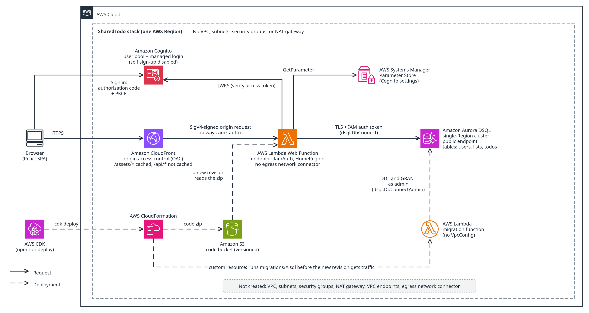

# VPC を使わない AWS Lambda Web Functions と Amazon Aurora DSQL によるアプリケーション

[English](README.md)

## 概要

AWS Lambda Web Functions と Amazon Aurora DSQL で動くアプリケーションです。**VPC、サブネット、セキュリティグループ、NAT ゲートウェイを作りません**。データは外部キーで関連づけた複数のテーブルに置き、PostgreSQL 互換の SQL を使い `JOIN` で読み出します。題材は共有の TODO リストです。サインインした人は全員で、すべてのリストと TODO を共有します。

> [!IMPORTANT]
> これは本番環境での利用を想定していないサンプルコードです。デプロイする前に、自組織のセキュリティ・法務の担当者と、セキュリティ、規制、コンプライアンスの要件を満たしているか確認してください。

## 構成



リクエストの流れ:

1. ブラウザは CloudFront にだけアクセスします。
2. CloudFront は署名付きのリクエストで Web Function を呼び、Web Function は署名の無いリクエストを受け付けません([`cdk/lib/todo-stack.ts`](cdk/lib/todo-stack.ts))。
3. Web Function は Cognito のアクセストークンを確かめてから保護対象の API を処理します([`server/src/middleware.ts`](server/src/middleware.ts))。
4. Web Function はパスワードではなく IAM 認証で Aurora DSQL につなぎます([`server/src/db.ts`](server/src/db.ts))。

テーブルは `users`、`lists`、`todos` の 3 つです([`migrations/`](migrations/)、[`server/src/repository.ts`](server/src/repository.ts))。

## 前提条件

- Node.js 24 以降、npm、認証情報を設定した AWS CLI v2
- [Lambda Web Functions](https://docs.aws.amazon.com/lambda/latest/dg/web-functions.html) と [Aurora DSQL](https://docs.aws.amazon.com/aurora-dsql/latest/userguide/what-is-aurora-dsql.html) の両方が使えるリージョン([リージョンごとのサービス](https://aws.amazon.com/about-aws/global-infrastructure/regional-product-services/))
- デプロイ先のアカウントとリージョンは AWS CLI の設定で決まります。名前付きプロファイルを使うときは、先に `export AWS_PROFILE=<name>` を実行します

## デプロイ

変更する設定は [`config.ts`](config.ts) にまとまっています。既定のままでもデプロイできます。スタック名 `stackName` の既定は `SharedTodo` です。

1. 依存関係を入れてビルドします。

   ```sh
   npm ci
   npm run build
   ```

2. 初めて CDK を使うアカウントとリージョンでは、1 度だけ[ブートストラップ](https://docs.aws.amazon.com/cdk/v2/guide/bootstrapping.html)します(済んでいるかは `aws cloudformation describe-stacks --stack-name CDKToolkit` で確かめられます)。

   ```sh
   npx cdk bootstrap
   ```

3. デプロイします。

   ```sh
   npm run deploy
   ```

`npm run deploy` の途中で IAM の変更の確認を求められるので、`y` と答えます。5〜10 分ほどかかります。スタックの出力は `AppUrl`、`UserPoolId`、`NextStep`、`EndpointUrl` です。

### ユーザーを作る

自分でのサインアップは無効にしてあるので、出力の `NextStep` にあるコマンドでユーザーを作ります。`you@example.com` を自分のメールアドレスに変えて実行すると、Cognito から仮のパスワードがメールで届きます。

サインインのしかたは「[使い方](#使い方)」の節にあります。

<details>
<summary>メールを受け取らずに試す</summary>

`NextStep` のコマンドに `--message-action SUPPRESS` を足して実行し、次のスクリプトでパスワードを設定します(bash と zsh で動きます)。スクリプトの `<UserPoolId>` は出力の `UserPoolId` に置き換えます。`Username` は `NextStep` のコマンドの `--username` と同じ値(`alice`)にします。

```sh
F=$(mktemp); trap 'rm -f "$F"' EXIT HUP INT TERM   # リポジトリ外。終了時に削除
printf 'New password: '; IFS= read -rs PASSWORD; echo
printf '%s' "$PASSWORD" | node -e 'process.stdout.write(JSON.stringify({UserPoolId: process.argv[1], Username: "alice", Password: require("fs").readFileSync(0, "utf8"), Permanent: true}))' "<UserPoolId>" > "$F"; unset PASSWORD
aws cognito-idp admin-set-user-password --cli-input-json "file://$F"; rm -f "$F"
```

</details>

## 使い方

`AppUrl` を開き、作ったユーザーでサインインして、リストと TODO を作ります。仮のパスワードでサインインしたときは、新しいパスワードを決める画面が出ます。画面は、ブラウザの言語に合わせて英語か日本語で表示されます。

### ログとメトリクス

- ログ: `/aws/lambda/web/<stackName>`。Aurora DSQL で競合が起きてリトライすると、1 回につき 1 行(`conflict`、`attempt`)出ます。リクエストを 1 件ずつは記録しません([Web Function のログ](https://docs.aws.amazon.com/lambda/latest/dg/web-functions-logging.html))。
- メトリクス: CloudWatch の名前空間 `AWS/AuroraDSQL`(`OccConflicts`、`TotalDPU`)([メトリクス](https://docs.aws.amazon.com/aurora-dsql/latest/userguide/cloudwatch-monitoring.html))。SQL 文ごとの負荷は、設定なしで [Database Insights](https://docs.aws.amazon.com/aurora-dsql/latest/userguide/dsql-db-insights.html) から見られます。

## 費用

使っていない間にかかるのは、データベース、コードのバケット、ログのストレージの料金です。CloudFront と Cognito(既定の Essentials プラン)には毎月の無料枠があります。使う量に合わせた費用は、[Lambda](https://aws.amazon.com/lambda/pricing/)、[Aurora DSQL](https://aws.amazon.com/rds/aurora/dsql/pricing/)、[CloudFront](https://aws.amazon.com/cloudfront/pricing/)、[Cognito](https://aws.amazon.com/cognito/pricing/) の料金ページと [AWS Pricing Calculator](https://calculator.aws/) で見積もってください。

## 後片付け

使い終わったら削除します。デプロイしている間は、URL を知っていれば誰でもリクエストを送れます。

```sh
npm run destroy
```

確認を求められたら `y` と答えます。5〜10 分ほどかかります。リストと TODO、ユーザープールと全ユーザーが消えます。`config.ts` でクラスターの削除保護を有効にした場合は、無効にしてデプロイしてから削除してください。

`destroy` のあとにロググループが 1 つ残るので、次のコマンドで探して削除します。

```sh
aws logs describe-log-groups --log-group-name-prefix /aws/lambda/<stackName>-CustomS3AutoDeleteObjects --query 'logGroups[].logGroupName' --output text
aws logs delete-log-group --log-group-name <一覧の名前>
```

## 本番に向けて検討すること

**認証**

- refresh token rotation を使い、トークンの寿命を見直す([refresh token rotation](https://docs.aws.amazon.com/cognito/latest/developerguide/amazon-cognito-user-pools-using-the-refresh-token.html#using-the-refresh-token-rotation)、[トークンの失効](https://docs.aws.amazon.com/cognito/latest/developerguide/token-revocation.html))
- Cognito の [MFA](https://docs.aws.amazon.com/cognito/latest/developerguide/user-pool-settings-mfa.html)、[脅威保護](https://docs.aws.amazon.com/cognito/latest/developerguide/cognito-user-pool-settings-threat-protection.html)(Plus プラン)、[削除保護](https://docs.aws.amazon.com/cognito/latest/developerguide/user-pool-settings-deletion-protection.html)を有効にする

**入口とアクセスの経路**

- [AWS WAF](https://docs.aws.amazon.com/AmazonCloudFront/latest/DeveloperGuide/distribution-web-awswaf.html) で IP ごとのレートベースルールを置く(エンドポイントの `rateLimit` は全利用者で 1 つの上限です)
- 最小 TLS バージョンを決めるために[独自ドメイン](https://docs.aws.amazon.com/AmazonCloudFront/latest/DeveloperGuide/CNAMEs.html)を使う
- アカウント内からエンドポイントや Aurora DSQL へ直接届く権限を絞る。`lambda:InvokeWebFunctionEndpoint` があれば CloudFront を通さずにエンドポイントを呼べるので、IAM ポリシーで許す主体を絞る。`lambda:*` や AdministratorAccess のような広い権限にもこのアクションが含まれる([エンドポイントのアクセス制御](https://docs.aws.amazon.com/lambda/latest/dg/web-functions-endpoint-access-control.html))。`dsql:DbConnect` / `dsql:DbConnectAdmin` は、IAM とクラスターの[リソースベースのポリシー](https://docs.aws.amazon.com/aurora-dsql/latest/userguide/resource-based-policies.html)で Web Function とマイグレーションのロールに絞る

**データの保護**

- Aurora DSQL クラスターの削除保護を有効にし、[バックアップ](https://docs.aws.amazon.com/aurora-dsql/latest/userguide/backup-aurora-dsql.html)を取る

**容量**

- 利用量に合わせて `maxEnvironments`、`rateLimit`、`pool.max` を決め、`maxEnvironments` × `pool.max` を Aurora DSQL の[接続数のクォータ](https://docs.aws.amazon.com/aurora-dsql/latest/userguide/CHAP_quotas.html)の内に収める(`config.ts` を参照)

**監視とログ**

- [CloudFront](https://docs.aws.amazon.com/AmazonCloudFront/latest/DeveloperGuide/AccessLogs.html) と [S3](https://docs.aws.amazon.com/AmazonS3/latest/userguide/ServerLogs.html) のアクセスログを有効にする(このサンプルでは有効にしていません)
- [アラーム](https://docs.aws.amazon.com/lambda/latest/dg/lambda-monitoring.html)を置き、ログの保存期間を決める。[`EndpointActiveEnvironments` と `EndpointActiveEnvironmentThrottles`](https://docs.aws.amazon.com/lambda/latest/dg/web-functions-scaling.html) も監視する

## Security

詳しくは [CONTRIBUTING](CONTRIBUTING.md#security-issue-notifications) を参照してください。

## License

このライブラリは MIT-0 ライセンスで提供されます。[LICENSE](LICENSE) を参照してください。
